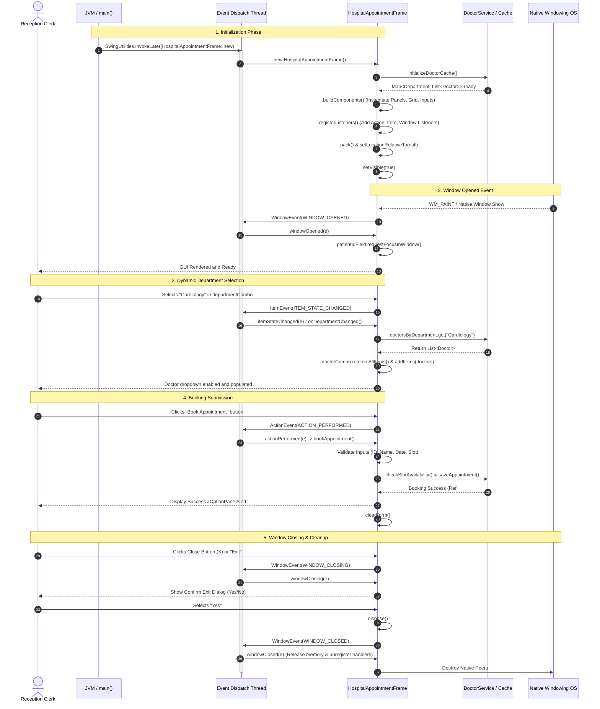

# Task 02 – Hospital Outpatient Appointment: Requirement to Event-Driven Design

**Course:** Programming in Java (CSA09)  
**Assignment:** Assignment 4 – CO4 Event-Driven GUI Design  
**Student:** Ranjith Kumar.R  
**Register Number:** 1924L260003  
**IDE:** Antigravity | **Java Version:** Java 27  

---

## 1. Scenario and Objective

A hospital outpatient appointment desk utilizes a desktop application to book patient appointments with consulting doctors. The hospital reception clerk interacts with the GUI by:
1. Entering patient identification details (Patient ID, Patient Name).
2. Selecting a medical department (e.g., Cardiology, Neurology, Orthopedics, Pediatrics, General Medicine).
3. Choosing an available doctor from the dynamically populated doctor list corresponding to the selected department.
4. Specifying the appointment date (using a date spinner) and appointment time slot (using a combo box).
5. Entering the primary clinical reason for the visit into a multi-line text area.
6. Submitting the booking request, clearing the form, or safely exiting the application.

### Objective
The objective of this design is to map all user interactions, component state transitions, and window lifecycle events to appropriate Java AWT/Swing event models (`java.awt.event.*`). The architecture strictly enforces the **Separation of Concerns (SoC)** principle:
- **Presentation Layer (`HospitalAppointmentFrame`):** Manages component containment, layout rendering, visual validation feedback, and event delegation.
- **Service & Domain Layer (`DoctorService`, `AppointmentService`):** Manages doctor lookups, data grouping, scheduling validation, slot collision detection, and persistence.

### Design Assumptions
- Each doctor is primarily associated with a specific medical department.
- A booking is valid only when all required fields are populated, the selected doctor belongs to the specified department, the appointment date is not in the past, and the time slot is currently unoccupied.
- In accordance with Task 02 instructions, this submission constitutes a complete event-driven design specification, containment model, sequence analysis, and pseudocode architecture.

---

## 2. Event Table

The table below maps each GUI component and window event source to its corresponding AWT/Swing Event Object, Listener Interface / Adapter, and concrete event-handling action.

| Event Source Component | Event Object | Listener Interface / Adapter Class | Method Triggered & Action Performed |
|---|---|---|---|
| **Department `JComboBox<String>`** | `ItemEvent` / `ActionEvent` | `ItemListener` / `ActionListener` | `itemStateChanged(ItemEvent e)` / `actionPerformed(ActionEvent e)`:<br>Detects department change, checks if `e.getStateChange() == ItemEvent.SELECTED`, reads the selected department, and invokes `refreshDoctorList(selectedDept)` to dynamically populate the doctor dropdown. |
| **Appointment Date `JSpinner`** | `ChangeEvent` | `ChangeListener` | `stateChanged(ChangeEvent e)`:<br>Validates that the newly selected date is not prior to the current system date (`LocalDate.now()`). Updates the status label if a past date is selected. |
| **Book Appointment `JButton`** | `ActionEvent` | `ActionListener` | `actionPerformed(ActionEvent e)`:<br>Triggers `bookAppointment()`. Collects form inputs, invokes `AppointmentService` to validate constraints and verify slot availability, displays confirmation or error alerts via `JOptionPane`, and updates the status bar. |
| **Clear `JButton`** | `ActionEvent` | `ActionListener` | `actionPerformed(ActionEvent e)`:<br>Triggers `clearForm()`. Resets all text fields (`setText("")`), resets combo boxes to default index `0`, clears doctor selections, resets date spinner to today, and clears status messages. |
| **Exit `JButton`** | `ActionEvent` | `ActionListener` | `actionPerformed(ActionEvent e)`:<br>Triggers `handleExit()`. Prompts the user with a confirmation dialog (`JOptionPane.showConfirmDialog`). If confirmed, invokes `frame.dispose()` to trigger window cleanup. |
| **Patient ID `JTextField`** | `FocusEvent` | `FocusListener` / `FocusAdapter` | `focusLost(FocusEvent e)`:<br>Performs early inline validation. Verifies whether the ID meets the hospital format (e.g., alphanumeric string) and updates the status indicator if blank. |
| **Hospital Appointment `JFrame` (Window Opened)** | `WindowEvent` | `WindowListener` / `WindowAdapter` | `windowOpened(WindowEvent e)`:<br>Fired when the frame is first made visible. Initializes the doctor cache (`initializeDoctorCache()`), requests initial keyboard focus for `patientIdField`, and displays the welcome status message. |
| **Hospital Appointment `JFrame` (Window Closing)** | `WindowEvent` | `WindowListener` / `WindowAdapter` | `windowClosing(WindowEvent e)`:<br>Fired when the user clicks the title bar close box (`X`). Displays a confirmation dialog if unsaved appointment data is present, closes active database/service connections, and disposes the frame. |
| **Hospital Appointment `JFrame` (Window Closed)** | `WindowEvent` | `WindowListener` / `WindowAdapter` | `windowClosed(WindowEvent e)`:<br>Fired after `dispose()` completes. Releases native OS display resources and cleanly terminates the application if no other windows exist (`System.exit(0)`). |

---

## 3. Component Containment Tree

The component containment tree below illustrates the complete hierarchical structure of AWT/Swing components, container panels, borders, and layout managers.

```text
HospitalAppointmentFrame (extends JFrame)
│   [Layout: BorderLayout(0, 10)]
│   [DefaultCloseOperation: DO_NOTHING_ON_CLOSE (handled by WindowListener)]
│
└── contentPane (Container: BorderLayout)
    │
    ├── NORTH: headerPanel (JPanel)
    │   │   [Layout: FlowLayout(FlowLayout.CENTER, 10, 12)]
    │   │   [Background: Primary Brand Blue / Header Theme]
    │   └── titleLabel (JLabel)
    │           [Text: "Hospital Outpatient Appointment Booking System"]
    │           [Font: Bold 18pt SansSerif]
    │
    ├── CENTER: formPanel (JPanel)
    │   │   [Layout: GridLayout(0, 2, 12, 12)]
    │   │   [Border: EmptyBorder(15, 25, 15, 25)]
    │   │
    │   ├── patientIdLabel (JLabel: "Patient ID / Hospital No *:")
    │   ├── patientIdField (JTextField: columns=20)
    │   │
    │   ├── patientNameLabel (JLabel: "Patient Full Name *:")
    │   ├── patientNameField (JTextField: columns=20)
    │   │
    │   ├── departmentLabel (JLabel: "Medical Department *:")
    │   ├── departmentCombo (JComboBox<String>: ["-- Select Department --", "Cardiology", "Neurology", "Orthopedics", "Pediatrics", "General Medicine"])
    │   │
    │   ├── doctorLabel (JLabel: "Consulting Doctor *:")
    │   ├── doctorCombo (JComboBox<Doctor>: disabled until department is chosen)
    │   │
    │   ├── appointmentDateLabel (JLabel: "Appointment Date *:")
    │   ├── appointmentDateSpinner (JSpinner: SpinnerDateModel)
    │   │
    │   ├── appointmentTimeLabel (JLabel: "Appointment Time Slot *:")
    │   ├── appointmentTimeCombo (JComboBox<String>: ["-- Select Slot --", "09:00 AM", "09:30 AM", "10:00 AM", "10:30 AM", "11:00 AM", "02:00 PM", "02:30 PM", "03:00 PM"])
    │   │
    │   ├── visitReasonLabel (JLabel: "Reason for Visit / Symptoms:")
    │   └── visitReasonScrollPane (JScrollPane: VERTICAL_SCROLLBAR_AS_NEEDED)
    │       └── visitReasonArea (JTextArea: rows=3, columns=20, lineWrap=true, wrapStyleWord=true)
    │
    └── SOUTH: footerPanel (JPanel)
        │   [Layout: BorderLayout(0, 5)]
        │   [Border: EmptyBorder(10, 20, 15, 20)]
        │
        ├── CENTER: buttonPanel (JPanel)
        │   │   [Layout: FlowLayout(FlowLayout.RIGHT, 15, 5)]
        │   ├── bookButton (JButton: "Book Appointment" [Default Button])
        │   ├── clearButton (JButton: "Clear Form")
        │   └── exitButton (JButton: "Exit")
        │
        └── SOUTH: statusPanel (JPanel)
            │   [Layout: BorderLayout()]
            │   [Border: BevelBorder(LOWERED)]
            └── statusLabel (JLabel: "Ready. Select a department to begin.")
                    [Font: Plain 11pt, Foreground: Dark Gray]
```

### Layout Strategy Justification
1. **`BorderLayout` (Root ContentPane):** Establishes standard desktop top-to-bottom ergonomics: Title Banner at `NORTH`, Data Form in `CENTER`, and Action Controls/Status Bar at `SOUTH`.
2. **`GridLayout(0, 2, 12, 12)` (Form Panel):** Guarantees uniform alignment between prompt labels (column 1) and user input widgets (column 2), preserving visual hierarchy regardless of platform DPI scaling.
3. **`JScrollPane` wrapping `JTextArea`:** Prevents long multi-line symptom entries from breaking the fixed grid dimensions or distorting parent window geometry.
4. **`FlowLayout(FlowLayout.RIGHT)` (Button Panel):** Aligns primary actions to the bottom right, adhering to standard desktop UX conventions where confirmation/submission sits furthest right.

---

## 4. Doctor List Refresh Pseudocode

To provide instant, zero-latency combo box updates without repeated database queries, doctor records are grouped in memory using a hash map:
`Map<String, List<Doctor>> doctorsByDepartment`.

```text
// ============================================================================
// DATA STRUCTURES & DEFINITIONS
// ============================================================================
CLASS Doctor:
    doctorId: String
    doctorName: String
    departmentName: String
    qualification: String

    METHOD toString() -> String:
        RETURN doctorName + " (" + qualification + ")"
END CLASS

GLOBAL doctorsByDepartment: Map<String, List<Doctor>> <- new HashMap<>()

// ============================================================================
// 1. CACHE INITIALIZATION (Run once during window initialization)
// ============================================================================
PROCEDURE initializeDoctorCache()
    TRY:
        // Load active doctors from repository or database
        allDoctors <- DoctorRepository.fetchActiveDoctors()
        doctorsByDepartment.clear()

        FOR EACH doc IN allDoctors:
            dept <- doc.departmentName
            IF NOT doctorsByDepartment.containsKey(dept) THEN
                doctorsByDepartment.put(dept, new ArrayList<Doctor>())
            END IF
            doctorsByDepartment.get(dept).add(doc)
        END FOR
    CATCH DatabaseException ex:
        statusLabel.setText("Error loading doctor directory: " + ex.getMessage())
    END TRY
END PROCEDURE

// ============================================================================
// 2. DYNAMIC REFRESH ON DEPARTMENT SELECTION CHANGE
// ============================================================================
PROCEDURE onDepartmentChanged()
    selectedDept <- departmentCombo.getSelectedItem()

    // Clear previous doctor entries
    doctorCombo.removeAllItems()

    // Validate selection against placeholder
    IF selectedDept is NULL OR selectedDept EQUALS "-- Select Department --" THEN
        doctorCombo.setEnabled(FALSE)
        statusLabel.setText("Please select a medical department.")
        RETURN
    END IF

    // Retrieve matching doctors from the hash map in O(1) time
    matchingDoctors <- doctorsByDepartment.get(selectedDept)

    IF matchingDoctors is NULL OR matchingDoctors.isEmpty() THEN
        doctorCombo.setEnabled(FALSE)
        statusLabel.setText("No active doctors available in " + selectedDept + ".")
        RETURN
    END IF

    // Populate doctor combo box
    FOR EACH doctor IN matchingDoctors:
        doctorCombo.addItem(doctor)
    END FOR

    doctorCombo.setEnabled(TRUE)
    doctorCombo.setSelectedIndex(0)
    statusLabel.setText("Loaded " + matchingDoctors.size() + " doctor(s) for " + selectedDept + ".")
END PROCEDURE
```

---

## 5. Appointment Validation and Booking Pseudocode

```text
// ============================================================================
// APPOINTMENT VALIDATION AND SUBMISSION WORKFLOW
// ============================================================================
PROCEDURE bookAppointment()
    // ------------------------------------------------------------------------
    // Step 1: Extract and Sanitize Form Inputs
    // ------------------------------------------------------------------------
    patientId       <- TRIM(patientIdField.getText())
    patientName     <- TRIM(patientNameField.getText())
    selectedDept    <- (String) departmentCombo.getSelectedItem()
    selectedDoctor  <- (Doctor) doctorCombo.getSelectedItem()
    appointmentDate <- (Date) appointmentDateSpinner.getValue()
    selectedTime    <- (String) appointmentTimeCombo.getSelectedItem()
    visitReason     <- TRIM(visitReasonArea.getText())

    // ------------------------------------------------------------------------
    // Step 2: Validate Required Fields & Input Integrity
    // ------------------------------------------------------------------------
    IF patientId is EMPTY THEN
        SHOW_ERROR_DIALOG("Validation Error", "Patient ID / Hospital Number is required.")
        patientIdField.requestFocus()
        RETURN
    END IF

    IF patientName is EMPTY THEN
        SHOW_ERROR_DIALOG("Validation Error", "Patient Full Name is required.")
        patientNameField.requestFocus()
        RETURN
    END IF

    IF selectedDept is NULL OR selectedDept EQUALS "-- Select Department --" THEN
        SHOW_ERROR_DIALOG("Validation Error", "Please select a valid Medical Department.")
        departmentCombo.requestFocus()
        RETURN
    END IF

    IF selectedDoctor is NULL THEN
        SHOW_ERROR_DIALOG("Validation Error", "Please select an available Consulting Doctor.")
        doctorCombo.requestFocus()
        RETURN
    END IF

    // Verify domain consistency
    IF selectedDoctor.departmentName NOT EQUALS selectedDept THEN
        SHOW_ERROR_DIALOG("Validation Error", "Doctor specialization does not match the chosen department.")
        RETURN
    END IF

    // Validate that appointment date is today or in the future
    todayStart <- GET_START_OF_DAY(CURRENT_DATE())
    IF appointmentDate IS BEFORE todayStart THEN
        SHOW_ERROR_DIALOG("Validation Error", "Appointment date cannot be in the past.")
        appointmentDateSpinner.requestFocus()
        RETURN
    END IF

    IF selectedTime is NULL OR selectedTime EQUALS "-- Select Slot --" THEN
        SHOW_ERROR_DIALOG("Validation Error", "Please select an appointment time slot.")
        appointmentTimeCombo.requestFocus()
        RETURN
    END IF

    IF visitReason is EMPTY THEN
        SHOW_ERROR_DIALOG("Validation Error", "Please provide a brief reason for the visit / symptoms.")
        visitReasonArea.requestFocus()
        RETURN
    END IF

    // ------------------------------------------------------------------------
    // Step 3: Check Slot Availability & Concurrency
    // ------------------------------------------------------------------------
    statusLabel.setText("Checking slot availability...")
    
    isAvailable <- AppointmentService.checkSlotAvailability(
        selectedDoctor.doctorId,
        appointmentDate,
        selectedTime
    )

    IF NOT isAvailable THEN
        SHOW_WARNING_DIALOG(
            "Slot Unavailable",
            "Dr. " + selectedDoctor.doctorName + " is already fully booked at " 
            + selectedTime + " on " + FORMAT_DATE(appointmentDate) + ".\nPlease choose another time slot."
        )
        appointmentTimeCombo.requestFocus()
        statusLabel.setText("Slot collision detected. Choose an alternative slot.")
        RETURN
    END IF

    // ------------------------------------------------------------------------
    // Step 4: Construct Appointment Entity & Process Booking
    // ------------------------------------------------------------------------
    appointmentEntity <- NEW Appointment(
        patientId       = patientId,
        patientName     = patientName,
        department      = selectedDept,
        doctor          = selectedDoctor,
        date            = appointmentDate,
        timeSlot        = selectedTime,
        reason          = visitReason,
        bookingTimestamp = CURRENT_TIMESTAMP()
    )

    bookingResult <- AppointmentService.saveAppointment(appointmentEntity)

    // ------------------------------------------------------------------------
    // Step 5: Deliver User Feedback
    // ------------------------------------------------------------------------
    IF bookingResult.isSuccess() THEN
        bookingRef <- bookingResult.getBookingReference()
        
        statusLabel.setText("Appointment confirmed: " + bookingRef)
        
        SHOW_INFORMATION_DIALOG(
            "Booking Confirmed",
            "APPOINTMENT BOOKED SUCCESSFULLY!\n\n" +
            "Booking Reference: " + bookingRef + "\n" +
            "Patient: " + patientName + " (" + patientId + ")\n" +
            "Doctor: Dr. " + selectedDoctor.doctorName + "\n" +
            "Department: " + selectedDept + "\n" +
            "Date & Time: " + FORMAT_DATE(appointmentDate) + " at " + selectedTime
        )
        
        // Reset form for next patient registration
        clearForm()
    ELSE
        statusLabel.setText("Booking failed: " + bookingResult.getErrorMessage())
        SHOW_ERROR_DIALOG("Booking Failed", "System error: " + bookingResult.getErrorMessage())
    END IF
END PROCEDURE
```

---

## 6. Window Method-Call Sequence (Opening to Closing)

The execution trace below details the complete lifecycle from application bootstrap to window disposal:



### Detailed Sequence Steps
1. **JVM Entry:** `main()` executes on the main thread and delegates GUI initialization to the EDT via `SwingUtilities.invokeLater()`.
2. **Component & Listener Construction:** `HospitalAppointmentFrame` initializes in-memory cache data, instantiates UI components, and attaches dedicated listeners.
3. **Display & Focus:** Calling `setVisible(true)` invokes native peers. The window manager fires a `WindowEvent.WINDOW_OPENED`, causing `windowOpened()` to route keyboard focus directly to `patientIdField`.
4. **Interaction Handling:** Every combo-box selection or button tap creates an event object (`ItemEvent`, `ChangeEvent`, `ActionEvent`) queued on the AWT EventQueue and dispatched sequentially on the EDT.
5. **Window Close & Resource Reclamation:** Clicking `X` triggers `windowClosing()`. After user confirmation, `frame.dispose()` releases native display peers, fires `windowClosed()`, and allows the JVM to terminate cleanly.

---

## 7. JFrame Window Event Sequence vs. Applet Lifecycle Comparison

Both Java Swing `JFrame` windows and legacy Java `Applet` / `JApplet` architectures handle graphic display and lifecycle management, but their invocation models, container hosts, and callback triggers differ fundamentally:

| Applet Lifecycle Method | Purpose in Applet Architecture | Closest Equivalent in `JFrame` Design | Key Differences & Behavioral Contrasts |
|---|---|---|---|
| **`init()`** | Called once by the browser / appletviewer after loading to initialize variables and UI components. | **Constructor + `buildComponents()`** | An Applet's `init()` is called automatically by an external container (browser plugin). A `JFrame` constructor is explicitly called by application code on the EDT. |
| **`start()`** | Called by the browser after `init()`, and whenever the user returns to the web page containing the applet. | **`setVisible(true)` & `windowActivated()`** | An applet can start and stop multiple times as tabs/pages change. A `JFrame` window is activated when given focus and receives `windowActivated()` / `windowGainedFocus()`. |
| **`paint(Graphics g)`** | Renders custom graphics and visual elements on the canvas. | **`paintComponent(Graphics g)`** | Applets override `paint()`. Modern Swing applications override `paintComponent()` on lightweight components (`JPanel`) with automatic double-buffering. |
| **`stop()`** | Called automatically when the browser page is navigated away from; suspends animations/threads. | **`windowDeactivated()` / `windowIconified()`** | A `JFrame` has no automated "suspend" method; pausing background workers on minimizing must be manually hooked into `windowIconified()`. |
| **`destroy()`** | Called once when the applet is permanently unloaded from memory. | **`windowClosing()` / `dispose()` / `windowClosed()`** | Applet destruction is dictated by browser cache ejection. A `JFrame` is explicitly destroyed via `dispose()`, firing `windowClosed()` to release native peer handles. |

---

## 8. Architectural Comparison: Database Query vs. In-Memory Map

When designing dependent/cascading combo boxes (such as Department $\rightarrow$ Doctor), two primary architectural patterns exist:

| Evaluation Dimension | Approach A: Query Database on Every Department Change | Approach B: Pre-load Doctors Once into an In-Memory `Map` |
|---|---|---|
| **Execution Mechanism** | Executes `SELECT * FROM doctors WHERE dept = ?` over JDBC every time the user alters the department combo box. | Executes a single `SELECT * FROM doctors WHERE active = 1` during startup and groups records into `Map<String, List<Doctor>>`. |
| **User Experience & Latency** | **Variable & Laggy (50ms – 500ms+):** Dependent on network round-trip time, connection pool acquisition, and DB query processing. Freezes UI if run on EDT. | **Instantaneous (< 1ms):** In-memory pointer lookup via `HashMap.get(dept)` delivers immediate UI response. |
| **Memory Footprint** | **Minimal:** Retains only the active department's doctor objects in memory. | **Slightly Higher:** Retains all active doctors across all departments in application heap memory. |
| **Data Freshness** | **Real-Time:** Immediately reflects new doctor additions, department transfers, or emergency leaves made in the database. | **Snapshot-Based:** Reflects data at application launch. Mid-day doctor status changes require manual cache invalidation. |
| **Network & Server Load** | **High:** Rapid combo box browsing generates high query traffic against the database server. | **Very Low:** Exactly one query executed per client session during application startup. |
| **Concurrency & Thread Safety** | **Complex:** Requires `SwingWorker` or asynchronous threading to prevent freezing the Swing Event Dispatch Thread (EDT). | **Simple:** Read-only access from an immutable or synchronized map on the EDT is completely safe and non-blocking. |
| **Recommended Use Case** | Large enterprise systems with thousands of frequently changing doctors across hundreds of sub-specialties. | Desktop clinic stations, OPD registration desks, and standard hospital departments where the doctor roster is stable. |

---

## 9. Complexity Analysis

### Assumptions
- Let $N$ be the total number of active consulting doctors in the hospital across all departments.
- Let $D$ be the total number of medical departments ($D \ll N$).
- Let $K$ be the number of doctors in the selected department ($K \le N$, typically $5 \le K \le 20$).
- Let $M$ be the total number of booked appointments stored in the system.
- The `Map<String, List<Doctor>>` is implemented via standard Java `HashMap`, providing $O(1)$ average-case bucket access.

### 1. Doctor Lookup from Cache
- **Time Complexity:** $\mathcal{O}(1)$ average-case. Retrieving the doctor list for a department using `doctorsByDepartment.get(selectedDept)` performs a hash calculation and direct bucket lookup. In the worst-case hash collision scenario, it is $\mathcal{O}(D)$.
- **Space Complexity:** $\mathcal{O}(1)$ auxiliary space during lookup, returning a reference to the pre-existing `List<Doctor>`.

### 2. Doctor Combo-Box List Refresh
- **Time Complexity:** $\mathcal{O}(K)$ where $K$ is the number of doctors in the selected department. The UI clears existing entries (`removeAllItems()`, $\mathcal{O}(K_{old})$) and iterates $K$ times to execute `addItem(doctor)`.
- **Space Complexity:** $\mathcal{O}(K)$ auxiliary memory to hold the model elements in the `DefaultComboBoxModel`.

### 3. One-Time Cache Initialization (Startup)
- **Time Complexity:** $\mathcal{O}(N)$ to iterate through all $N$ doctor records retrieved from the database and insert them into their respective department lists.
- **Space Complexity:** $\mathcal{O}(N)$ total heap space to store references to $N$ `Doctor` objects partitioned across $D$ keys.

### 4. Appointment Validation and Booking
- **Time Complexity:**
  - **Input Field String Validation:** $\mathcal{O}(1)$ for fixed field checks (length bounds, null checks, date comparison).
  - **Slot Availability Check:** $\mathcal{O}(1)$ if queried against an in-memory hash set or indexed database table on `(doctor_id, appointment_date, time_slot)` ($\mathcal{O}(\log M)$ with a B-Tree index).
  - **Record Insertion:** $\mathcal{O}(1)$ average insertion time.
  - **Total Booking Time:** $\mathcal{O}(1)$ average algorithmic time.
- **Space Complexity:** $\mathcal{O}(1)$ auxiliary memory to create a single `Appointment` entity instance.

---

## 10. Summary and Conclusion

Task 02 establishes an event-driven architecture for hospital outpatient appointment booking:
1. **Event Model:** Clear separation of user interactions (`ActionEvent`, `ItemEvent`, `ChangeEvent`) and window states (`WindowEvent`).
2. **Containment Tree:** Organized GUI hierarchy combining `BorderLayout`, `GridLayout`, and nested panels for clean alignment.
3. **Decoupled Architecture:** Presentation logic in `HospitalAppointmentFrame` delegates data access and scheduling constraints to dedicated service layers.
4. **Optimized Data Retrieval:** In-memory grouped map lookup provides $\mathcal{O}(1)$ retrieval and $\mathcal{O}(K)$ combo box population, protecting the Swing EDT from network freezes.
5. **Validation & Integrity:** Multi-tier validation verifies required fields, date constraints, and slot availability before issuing booking confirmations.
