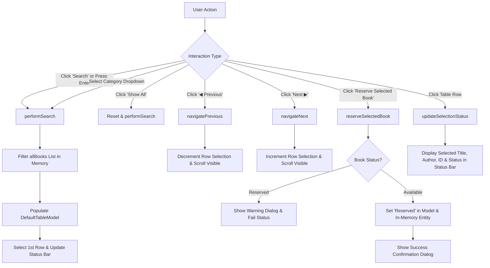

# Task 03 – Campus Library Search GUI: Layout Design Report

**Course:** Programming in Java (CSA09)  
**Assignment:** Assignment 4 – CO4 Event-Driven GUI Design  
**Student:** Ranjith Kumar.R  
**Register Number:** 1924L260003  
**IDE:** Antigravity | **Java Version:** Java 27  

---

## 1. Scenario and Design Objectives

A university library requires a desktop catalog search and reservation interface for students and staff. Users need to:
1. Search catalog books dynamically by keywords matching title, author, or book ID.
2. Filter the search results using academic disciplines/categories (e.g., Computer Science, Information Technology, Electronics, Mathematics, Mechanical).
3. View the matching books in a structured tabular format in the centre of the window.
4. Navigate sequentially across matching books using **Previous** (◀) and **Next** (▶) controls.
5. Reserve an available book directly through the GUI with immediate status and confirmation feedback.
6. Experience a responsive, professionally structured interface that scales cleanly when the window is resized.

### Key Architectural Objectives
- **Strict Avoidance of Absolute Positioning:** Avoid `setLayout(null)` or rigid pixel boundaries, allowing native cross-platform rendering and fluid window scaling.
- **Nested Layout Composition:** Leverage composite Swing layout managers (`BorderLayout` and `FlowLayout`) to separate heading, search controls, results view, action buttons, and status bar.
- **Dynamic Space Allocation:** Allocate 100% of horizontal and vertical expansion space to the central `JTable` / `JScrollPane`, while top search controls and bottom action bars maintain fixed, ergonomic heights.
- **Thread Safety:** Ensure all GUI creation, table modifications, and event listener dispatches occur safely on the Swing Event Dispatch Thread (EDT).

---

## 2. GUI Component Containment Tree

The containment hierarchy below details every container, panel, layout manager, and user interaction component utilized in `LibrarySearchApp.java`.

```text
LibrarySearchApp (extends JFrame)
│   [Layout: BorderLayout(0, 8)]
│   [DefaultCloseOperation: EXIT_ON_CLOSE]
│   [Initial Size: 700 x 500, Min Size: 600 x 400]
│
├── JMenuBar (Window Size Tests Helper)
│   └── JMenu: "Window Size (Resize Tests)"
│       ├── JMenuItem: "Compact (700 x 500)"
│       ├── JMenuItem: "Standard (900 x 600)"
│       └── JMenuItem: "Expanded (1200 x 800)"
│
└── contentPane (Container: BorderLayout)
    │
    ├── NORTH: topContainer (JPanel)
    │   │   [Layout: BorderLayout(0, 4)]
    │   │   [Border: EmptyBorder(10, 15, 6, 15)]
    │   │
    │   ├── NORTH: titlePanel (JPanel)
    │   │   │   [Layout: FlowLayout(FlowLayout.CENTER, 5, 5)]
    │   │   └── titleLabel (JLabel: "Campus Library Book Search System")
    │   │           [Font: Bold 19pt SansSerif, Foreground: Navy Blue]
    │   │
    │   └── SOUTH: searchControlsPanel (JPanel)
    │       │   [Layout: FlowLayout(FlowLayout.CENTER, 10, 6)]
    │       ├── keywordLabel (JLabel: "Search Keyword:")
    │       ├── searchField (JTextField: columns=16)
    │       ├── categoryLabel (JLabel: "Category:")
    │       ├── categoryCombo (JComboBox<String>: ["All Categories", "Computer Science", ...])
    │       ├── searchButton (JButton: "Search" [Bold 12pt])
    │       └── showAllButton (JButton: "Show All")
    │
    ├── CENTER: centerPanel (JPanel)
    │   │   [Layout: BorderLayout()]
    │   │   [Border: EmptyBorder(0, 15, 0, 15)]
    │   │
    │   └── tableScrollPane (JScrollPane)
    │       │   [Border: TitledBorder("Matching Catalog Books (Table Expands with Window)")]
    │       └── resultsTable (JTable)
    │           ├── tableModel (DefaultTableModel: read-only cells)
    │           │   └── Columns: ["Book ID", "Title", "Author", "Category", "Availability"]
    │           └── JTableHeader (Font: Bold 12pt SansSerif, Reordering: Disabled)
    │
    └── SOUTH: bottomContainer (JPanel)
        │   [Layout: BorderLayout(0, 4)]
        │   [Border: EmptyBorder(6, 15, 10, 15)]
        │
        ├── NORTH: buttonPanel (JPanel)
        │   │   [Layout: FlowLayout(FlowLayout.CENTER, 15, 6)]
        │   ├── prevButton (JButton: "◀ Previous")
        │   ├── nextButton (JButton: "Next ▶")
        │   └── reserveButton (JButton: "Reserve Selected Book" [Bold 12pt])
        │
        └── SOUTH: statusPanel (JPanel)
            │   [Layout: BorderLayout()]
            │   [Border: BevelBorder(LOWERED) + EmptyBorder(4, 8, 4, 8)]
            └── statusLabel (JLabel: "Ready. Welcome to Campus Library Search.")
                    [Font: Plain 12pt SansSerif]
```

---

## 3. Nested Panel Structure and Layout Manager Justification

| Container / Panel | Layout Manager Used | Architectural Justification |
|---|---|---|
| **Root `contentPane`** | `BorderLayout(0, 8)` | `BorderLayout` divides the window into distinct cardinal zones (`NORTH`, `CENTER`, `SOUTH`). This guarantees that the top search bar and bottom navigation remain pinned to window edges while all extra space is automatically allocated to `CENTER`. |
| **`topContainer`** | `BorderLayout(0, 4)` | Stacks the title header (`NORTH`) cleanly above the search input controls (`SOUTH`) without vertical stretching. |
| **`titlePanel`** | `FlowLayout(FlowLayout.CENTER)` | Centers the application branding label horizontally, maintaining consistent visual alignment across all screen resolutions. |
| **`searchControlsPanel`** | `FlowLayout(FlowLayout.CENTER, 10, 6)` | FlowLayout keeps search labels, text inputs, combo boxes, and query buttons arranged in a cohesive horizontal toolbar. Each widget retains its preferred size without artificial distortion. |
| **`centerPanel`** | `BorderLayout()` | Wrapping the `JScrollPane` inside `BorderLayout.CENTER` ensures that the table view absorbs 100% of the available width and height as the user resizes the window. |
| **`bottomContainer`** | `BorderLayout(0, 4)` | Organizes the interactive action buttons (`NORTH`) above the system status indicator (`SOUTH`), ensuring button clicks and status updates remain visually separated. |
| **`buttonPanel`** | `FlowLayout(FlowLayout.CENTER, 15, 6)` | Keeps the navigation and reservation buttons clustered together in the bottom center, adhering to common desktop application button ergonomics. |
| **`statusPanel`** | `BorderLayout()` | Allows `statusLabel` to stretch completely from left to right inside a lowered bevel border, replicating standard operating system status bars. |

---

## 4. Event Handling Architecture

The application wires focused event listeners to isolate user interaction handling:



### Detailed Event Handlers
1. **`performSearch()`:**
   - Triggered by `searchButton.addActionListener`, `searchField.addActionListener` (ENTER key), and `categoryCombo.addActionListener`.
   - Reads the entered keyword (case-insensitive substring check across title, author, and book ID) and category selection.
   - Clears `tableModel` and fills it with matching `Book` objects.
   - If results exist, highlights the first row and activates navigation; if empty, disables navigation/reserve buttons and notifies the user in `statusLabel`.
2. **`navigatePrevious()` & `navigateNext()`:**
   - Triggered by `prevButton` and `nextButton`.
   - Modifies the active row selection index in `resultsTable`, wraps around cleanly between boundaries ($0 \leftrightarrow \text{size}-1$), and calls `scrollRectToVisible()` to guarantee the active row is visible in the viewport.
3. **`reserveSelectedBook()`:**
   - Triggered by `reserveButton`.
   - Validates that a row is selected.
   - If the book is already `"Reserved"`, alerts the user with a warning `JOptionPane`.
   - If `"Available"`, marks the book entity as `"Reserved"`, updates column index 4 of `tableModel`, displays an information confirmation popup with collection instructions, and updates the status bar.
4. **`updateSelectionStatus()`:**
   - Triggered by `ListSelectionListener` on `resultsTable.getSelectionModel()`.
   - Updates `statusLabel` with the current row position and full book metadata.

---

## 5. Three Window-Size Test Cases and Observations

The layout was tested across the three mandatory window dimensions (easily verified via the built-in `Window Size (Resize Tests)` menu):

| Test Case | Window Dimension | Visual & Layout Observations | Component Behavior |
|---|---|---|---|
| **Test Case 1: Compact View** | **700 x 500** | - Initial baseline size.<br>- Title and search controls fit in one neat horizontal row.<br>- `JTable` displays approximately 10 visible rows with vertical scroll bar active.<br>- Navigation buttons and status bar are compact and readable. | Search panel and bottom action bar consume their fixed preferred heights ($\approx 85\text{px}$ top, $\approx 65\text{px}$ bottom); table gets the remaining $\approx 350\text{px}$ height. |
| **Test Case 2: Standard View** | **900 x 600** | - Table area expands by $+200\text{px}$ horizontally and $+100\text{px}$ vertically.<br>- All catalog columns (Title, Author, Category) have ample breathing space.<br>- Nearly all catalog rows become visible without scrolling.<br>- Top controls and bottom buttons remain centered and unchanged in height. | `BorderLayout.CENTER` absorbs 100% of the additional space. Column widths widen proportionally; search fields and buttons do not stretch vertically. |
| **Test Case 3: Expanded View** | **1200 x 800** | - Large desktop / full-screen workstation view.<br>- Results table expands to display full catalog without any vertical scroll truncation.<br>- Column text is fully visible with zero header clipping.<br>- Top controls maintain centered FlowLayout layout; status bar spans the full 1200px width. | Zero component overlapping or clipping. The nested layout maintains exact proportional aesthetics without distortion. |

---

## 6. Layout Manager Comparison

| Architectural Dimension | Nested Layouts (`BorderLayout` + `FlowLayout`) *(Implemented)* | `GridBagLayout` (Alternative) | Absolute Positioning (`setLayout(null)`) *(Anti-Pattern)* |
|---|---|---|---|
| **Design Approach** | Modular division of labor: `BorderLayout` manages zones, `FlowLayout` manages toolbar rows. | Single complex manager where every component is placed using `GridBagConstraints` (`gridx`, `gridy`, `weightx`, `weighty`, `fill`). | Manual hardcoding of $(x, y, \text{width}, \text{height})$ for each component using `setBounds()`. |
| **Code Readability & Simplicity** | **High:** Intuitive, clear, minimal boilerplate; easy to maintain and debug. | **Moderate / Low:** Highly verbose and prone to configuration errors due to numerous constraint properties. | **Low:** Cluttered with magic numbers and hardcoded coordinate math. |
| **Window Resizing Behavior** | **Fluid & Robust:** `CENTER` automatically expands while `NORTH` and `SOUTH` preserve heights. | **Flexible:** Can achieve identical scaling if `weightx`/`weighty` are correctly balanced. | **Completely Broken:** Components remain frozen in fixed coordinates, causing clipping, cutoffs, or huge dead spaces. |
| **Platform / OS Portability** | **Native:** Respects varying OS DPI scaling, font renderers, and look-and-feels (Windows, macOS, Linux). | **Native:** Adapts well across platforms when constraints are well designed. | **Fragile:** Breaks across platforms where font sizes or system borders differ by even a few pixels. |

---

## 7. Complexity Analysis

### Assumptions
- Let $N$ be the total number of books in the catalog ($N = 15$ in sample data, scalable to $10^5$).
- Let $M$ be the number of books matching the current search criteria ($M \le N$).
- String matching uses standard substring search (`contains()`).

### 1. Catalog Search and Filter (`performSearch`)
- **Time Complexity:** $\mathcal{O}(N \cdot L)$, where $L$ is the maximum string length of book titles/authors. Each book is inspected sequentially against the category and search keyword. Clearing and repopulating the table model with $M$ rows takes $\mathcal{O}(M)$ time. Total time is $\mathcal{O}(N \cdot L + M)$, which is $\mathcal{O}(N)$ for fixed string lengths.
- **Space Complexity:** $\mathcal{O}(M)$ auxiliary space to maintain the `displayedBooks` reference list and table rows.

### 2. Navigation (`navigatePrevious` / `navigateNext`)
- **Time Complexity:** $\mathcal{O}(1)$. Changing the selected row index in `ListSelectionModel` and calling `scrollRectToVisible()` executes in constant time.
- **Space Complexity:** $\mathcal{O}(1)$ auxiliary memory.

### 3. Book Reservation (`reserveSelectedBook`)
- **Time Complexity:** $\mathcal{O}(1)$. Accessing the selected index, validating current status, updating the in-memory `Book` entity, and calling `tableModel.setValueAt()` runs in constant time.
- **Space Complexity:** $\mathcal{O}(1)$ auxiliary memory.

---

## 8. Conclusion

`LibrarySearchApp` demonstrates the effective application of Java Swing nested layout design. By utilizing `BorderLayout` at the top level and embedding `FlowLayout` panels for controls, the application achieves a clean, responsive layout that seamlessly adapts to different window dimensions (700x500, 900x600, 1200x800). The implementation separates UI structure, event handling, and data models while maintaining full compatibility with Java 27.
