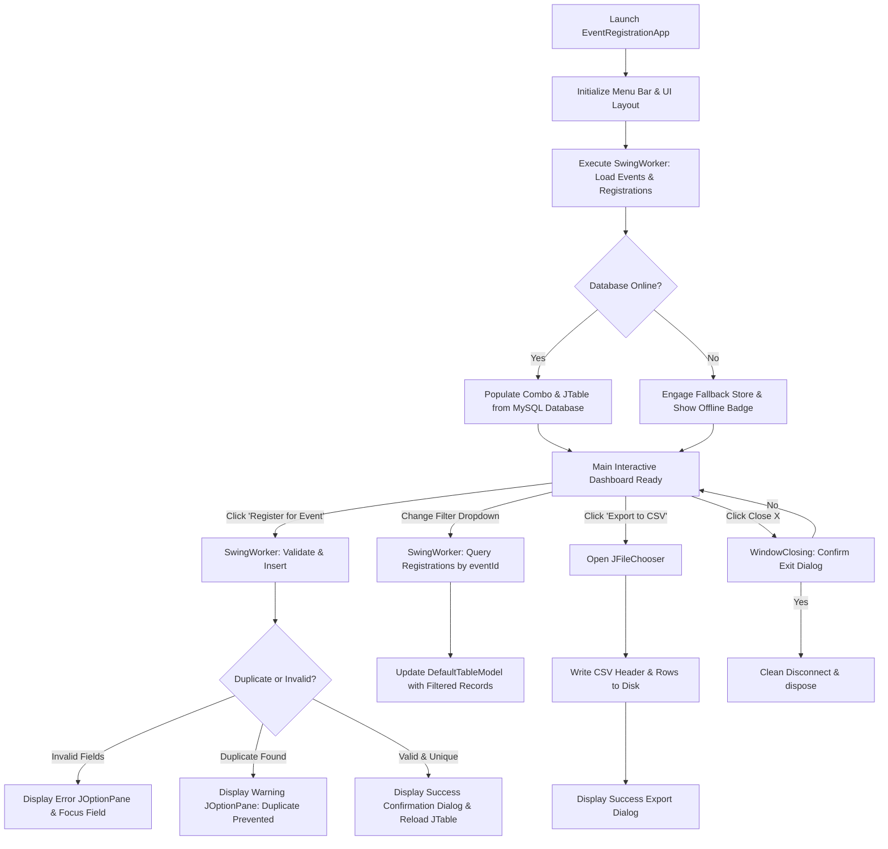
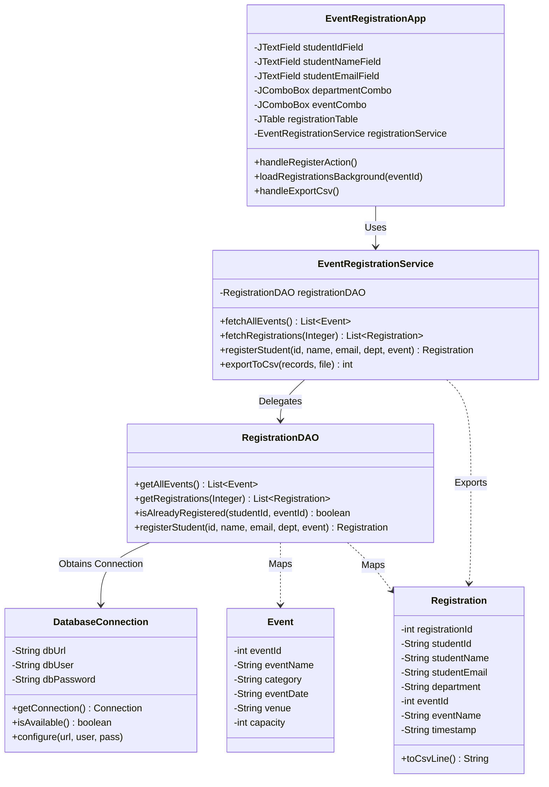

# Task 06 – Campus Event Registration: Design Challenge Report

**Course:** Programming in Java (CSA09)  
**Assignment:** Assignment 4 – CO4 Event-Driven GUI Design  
**Student:** Ranjith Kumar.R  
**Register Number:** 1924L260003  
**IDE:** Antigravity | **Java Version:** Java 27  
**Database:** MySQL 8.0+ via JDBC | **Architecture:** Multi-Tier MVC with `SwingWorker`  

---

## 1. Scenario and Design Objectives

A university campus hosts multiple extracurricular, technical, and academic events throughout the academic year (e.g., Hackathons, Technical Symposia, Robotics Expos, and Cultural Fests). The institution requires an integrated desktop event-management solution serving two distinct user groups:
1. **Students:** Registering for campus events by submitting personal and academic details.
2. **Organizing Committee Members:** Monitoring registrations in real time, filtering participants by event, and exporting registration rosters to CSV format for logistics and attendance tracking.

### Core Architectural Objectives
- **Strict Separation of Concerns (SoC):** Decouple presentation (`EventRegistrationApp`), business validation & rules (`EventRegistrationService`), and data persistence (`RegistrationDAO`, `DatabaseConnection`).
- **Responsive GUI via Asynchronous Execution:** Database operations (fetching events, querying rosters, submitting registrations) must never run on the Swing Event Dispatch Thread (EDT). All persistence calls run inside asynchronous `SwingWorker` threads.
- **Enforced Duplicate Prevention:** Ensure a student cannot register more than once for the same event, guarded both at the application service level and enforced as a database-level `UNIQUE KEY (student_id, event_id)` constraint.
- **Defensive JDBC Practice:** Use parameterized `PreparedStatement` exclusively to eliminate SQL injection vulnerabilities, and employ try-with-resources to prevent database connection leaks.

---

## 2. User Roles, Screens, Data Rules, and Testable Requirements

### User Roles
- **Student User:** Views active events, inputs identification information, receives real-time validation feedback, and obtains an immediate registration confirmation ID.
- **Committee Member:** Accesses the administrative dashboard, views all registrants in a sortable/filterable `JTable`, filters records by event, refreshes data from the database, and exports data to standard CSV files.

### Business Rules & Constraints
1. **Rule 1 (Duplicate Registration Constraint):** A student identified by `student_id` cannot register for the same `event_id` more than once. Re-registration attempts must be rejected with a warning dialog.
2. **Rule 2 (Mandatory Fields):** Student ID, Student Name, Email, Department, and Event Selection are mandatory. Blank or whitespace-only values must be rejected.
3. **Rule 3 (Email Format Integrity):** Email must adhere to valid RFC email syntax (`name@domain.tld`).
4. **Rule 4 (Data Persistence & Referrals):** Registrations must reference an active `event_id` through a foreign key constraint with cascading integrity.

### Testable Requirements Matrix

| Requirement ID | Description | Input / Trigger | Expected Outcome |
|---|---|---|---|
| **REQ-01** | Normal Valid Registration | Valid student details + Event chosen | Record persisted in database; success dialog with Reg ID; table refreshed. |
| **REQ-02** | Duplicate Rejection | Re-entering same Student ID + same Event | Database/Service detects duplicate; modal warning dialog; zero database duplication. |
| **REQ-03** | Missing Input Validation | Blank Student ID or Name | Validation halts on UI; red error status; focus routed to invalid field. |
| **REQ-04** | Email Format Validation | Invalid email (e.g., `user@@campus`) | Immediate rejection dialog: *"Please enter a valid email address"*. |
| **REQ-05** | Real-Time Event Filtering | Select specific event in filter combo | `JTable` updates instantly to show only registrants for that specific event. |
| **REQ-06** | CSV Data Export | Click "Export to CSV" | `JFileChooser` opens; valid CSV file written containing headers and formatted records. |
| **REQ-07** | EDT Non-Blocking UI | Slow DB query or connection probe | Progress bar animates; buttons disable during query; UI window remains draggable. |

---

## 3. Screen Layout Sketches & Dialog Flow

### Screen Layout Sketch

```text
+----------------------------------------------------------------------------------------------------+
| [Menu Bar] File  |  Database  |  Help                                                              |
+----------------------------------------------------------------------------------------------------+
|  CAMPUS EVENT REGISTRATION & COMMITTEE DASHBOARD                                                   |
|  Student Registration Form & Committee Member Real-Time Table                                      |
+--------------------------------------------+-------------------------------------------------------+
| STUDENT EVENT REGISTRATION                 | COMMITTEE REGISTRATION RECORDS                        |
|                                            |                                                       |
| Student ID *:    [______________________]  | Filter: [ All Campus Events        v ] [Refresh] [CSV]|
| Full Name *:     [______________________]  +-------------------------------------------------------+
| Email Address *: [______________________]  | Reg ID | Student ID | Name    | Dept | Event  | Time  |
| Department *:    [-- Select Dept --   v ]  |--------|------------|---------|------|--------|-------|
| Select Event *:  [-- Select Event --  v ]  | 1001   | 1924L26001 | Arun K  | CS   | Hack.. | 10:15 |
|                                            | 1002   | 1924L26002 | Bhavana | IT   | Hack.. | 11:30 |
|          [ Register for Event ]  [ Clear ] | 1003   | 1924L26003 | Ranjith | CS   | Symp.. | 14:00 |
|                                            |                                                       |
+--------------------------------------------+-------------------------------------------------------+
| Ready. Loaded 4 registration records.       [===== Progress Bar =====]  ● Live MySQL / Fallback    |
+----------------------------------------------------------------------------------------------------+
```

### Screen & Dialog Navigation Flow



---

## 4. Component Containment Tree and Event Table

### Component Containment Tree

```text
EventRegistrationApp (extends JFrame)
│   [Layout: BorderLayout(0, 8)]
│   [DefaultCloseOperation: DO_NOTHING_ON_CLOSE]
│
├── JMenuBar
│   ├── JMenu: "File" (Export, Refresh, Exit)
│   ├── JMenu: "Database" (Probe Connection, Connection Settings)
│   └── JMenu: "Help" (About Task 06)
│
└── contentPane (Container: BorderLayout)
    │
    ├── NORTH: bannerPanel (JPanel, BorderLayout)
    │   ├── titleLabel (JLabel: Bold 18pt White)
    │   └── subtitleLabel (JLabel: 12pt Light Blue)
    │
    ├── CENTER: splitPane (JSplitPane: HORIZONTAL_SPLIT, divider=360px)
    │   │
    │   ├── LEFT: formContainer (JPanel, BorderLayout)
    │   │   ├── NORTH: gridPanel (JPanel, GridLayout(5, 2, 8, 12))
    │   │   │   ├── studentIdLabel & studentIdField (JTextField)
    │   │   │   ├── studentNameLabel & studentNameField (JTextField)
    │   │   │   ├── studentEmailLabel & studentEmailField (JTextField)
    │   │   │   ├── departmentLabel & departmentCombo (JComboBox<String>)
    │   │   │   └── eventLabel & eventCombo (JComboBox<Event>)
    │   │   └── CENTER: buttonPanel (JPanel, FlowLayout.CENTER)
    │   │       ├── registerButton (JButton: Bold 12pt Green)
    │   │       └── clearButton (JButton: Plain 12pt)
    │   │
    │   └── RIGHT: dashboardContainer (JPanel, BorderLayout)
    │       ├── NORTH: filterBar (JPanel, FlowLayout.LEFT)
    │       │   ├── filterLabel & tableFilterCombo (JComboBox<Object>)
    │       │   ├── refreshButton (JButton)
    │       │   └── exportButton (JButton: Bold 11pt)
    │       └── CENTER: tableScrollPane (JScrollPane)
    │           └── registrationTable (JTable with DefaultTableModel)
    │
    └── SOUTH: bottomBar (JPanel, BorderLayout)
        ├── CENTER: statusLabel (JLabel: Plain 12pt)
        └── EAST: rightStatusPanel (JPanel, FlowLayout.RIGHT)
            ├── progressBar (JProgressBar: Indeterminate)
            └── dbStatusLabel (JLabel: Bold 11pt Connection Badge)
```

### Event Table

| Component | Event Object | Listener / Mechanism | Trigger & Handler Action |
|---|---|---|---|
| **Register Button** | `ActionEvent` | `ActionListener` | Invokes `handleRegisterAction()`. Gathers inputs, executes `SwingWorker` to validate and persist via service, displays success/duplicate alert, clears form, and updates table. |
| **Clear Button** | `ActionEvent` | `ActionListener` | Invokes `clearForm()`. Resets all input text fields, resets dropdown indices to `0`. |
| **Filter ComboBox** | `ActionEvent` | `ActionListener` | Invokes `loadRegistrationsBackground(eventId)`. Executes `SwingWorker` to filter table records dynamically. |
| **Export Button** | `ActionEvent` | `ActionListener` | Invokes `handleExportCsv()`. Launches `JFileChooser`, converts table model records into CSV format, and writes file. |
| **Probe DB Menu** | `ActionEvent` | `ActionListener` | Probes MySQL server on `localhost:3306` via background worker and updates UI status badge. |
| **Window Close (X)** | `WindowEvent` | `WindowAdapter` | Intercepts `windowClosing()`. Displays confirmation prompt before calling `dispose()`. |

---

## 5. Layered Architecture and Class Diagram



---

## 6. Registration and Filtering Pseudocode

### A. Student Registration Workflow
```text
PROCEDURE registerStudent(studentId, studentName, studentEmail, department, event)
    // 1. Validate Required Fields
    IF studentId IS EMPTY THEN THROW IllegalArgumentException("Student ID is required")
    IF studentName IS EMPTY THEN THROW IllegalArgumentException("Student Name is required")
    IF studentEmail IS EMPTY OR DOES NOT MATCH EMAIL_REGEX THEN 
        THROW IllegalArgumentException("Valid Email is required")
    IF department IS EMPTY OR department EQUALS "-- Select Department --" THEN 
        THROW IllegalArgumentException("Valid Department is required")
    IF event IS NULL THEN THROW IllegalArgumentException("Event must be selected")

    // 2. Asynchronous Background Execution via SwingWorker
    EXECUTE_ASYNC:
        TRY WITH RESOURCES (Connection conn = DatabaseConnection.getConnection()):
            // Early duplicate check
            checkSql <- "SELECT COUNT(*) FROM registrations WHERE student_id = ? AND event_id = ?"
            PREPARE STATEMENT psCheck WITH checkSql
            psCheck.setString(1, studentId)
            psCheck.setInt(2, event.getEventId())
            rs <- psCheck.executeQuery()

            IF rs.next() AND rs.getInt(1) > 0 THEN
                THROW DuplicateException("Student is already registered for this event.")
            END IF

            // Insert registration
            insertSql <- "INSERT INTO registrations (student_id, student_name, student_email, department, event_id) VALUES (?, ?, ?, ?, ?)"
            PREPARE STATEMENT psInsert WITH insertSql (RETURN_GENERATED_KEYS)
            psInsert.setString(1, studentId)
            psInsert.setString(2, studentName)
            psInsert.setString(3, studentEmail)
            psInsert.setString(4, department)
            psInsert.setInt(5, event.getEventId())
            psInsert.executeUpdate()

            newId <- GET_GENERATED_KEY(psInsert)
            RETURN NEW Registration(newId, studentId, studentName, studentEmail, department, event.id, event.name, NOW())

    ON_SUCCESS (in EDT):
        SHOW_DIALOG("Registration Confirmed! Reg ID: #" + newReg.id)
        clearForm()
        refreshTable()

    ON_DUPLICATE_ERROR (in EDT):
        SHOW_WARNING_DIALOG("Duplicate registration rejected for this student and event.")

    ON_VALIDATION_ERROR (in EDT):
        SHOW_ERROR_DIALOG(validationErrorMessage)
END PROCEDURE
```

### B. Event Filtering Workflow
```text
PROCEDURE filterRegistrations(selectedFilterEvent)
    EXECUTE_ASYNC:
        TRY WITH RESOURCES (Connection conn = DatabaseConnection.getConnection()):
            sql <- "SELECT r.*, e.event_name FROM registrations r JOIN events e ON r.event_id = e.event_id "
            IF selectedFilterEvent IS NOT NULL THEN
                sql <- sql + "WHERE r.event_id = ? "
            END IF
            sql <- sql + "ORDER BY r.registration_id DESC"

            PREPARE STATEMENT ps WITH sql
            IF selectedFilterEvent IS NOT NULL THEN
                ps.setInt(1, selectedFilterEvent.getEventId())
            END IF

            rs <- ps.executeQuery()
            records <- MAP_RESULT_SET_TO_REGISTRATION_LIST(rs)
            RETURN records

    ON_COMPLETE (in EDT):
        tableModel.setRowCount(0)
        FOR EACH reg IN records:
            tableModel.addRow(reg.id, reg.studentId, reg.studentName, reg.email, reg.department, reg.eventName, reg.timestamp)
        statusLabel.setText("Loaded " + records.size() + " records.")
END PROCEDURE
```

---

## 7. Comparative Performance Study: Loading 100,000 Registrations

Slide 11 requires analyzing the impact of loading **100,000 registration records** all at once vs. **paginated loading** using SQL `LIMIT` and `OFFSET`:

| Performance Dimension | Approach A: Load All 100,000 Records at Once | Approach B: Paginated Loading (`LIMIT 50 OFFSET ?`) |
|---|---|---|
| **SQL Query Executed** | `SELECT * FROM registrations ORDER BY registration_id DESC;` | `SELECT * FROM registrations ORDER BY registration_id DESC LIMIT 50 OFFSET 0;` |
| **Network Payload & Data Transfer** | **Massive ($\approx 25\text{ MB} - 40\text{ MB}$):** The database serializes all 100,000 tuples across the JDBC network socket. | **Negligible ($\approx 15\text{ KB}$):** Only 50 rows serialized per page request. |
| **Heap Memory Overhead** | **Extreme ($\approx 80\text{ MB} - 120\text{ MB}$):** Allocates 100,000 `Registration` domain objects, table vectors, and GUI cell renderers. Can trigger high GC pauses or `OutOfMemoryError` on low-spec client machines. | **Constant ($\approx 50\text{ KB}$):** Retains only 50 active row objects in memory at any given time. |
| **Initial Query Latency** | **Severe (3.5s – 8.0s+):** Full table scan, network transmission delay, and object instantiation time delay screen display. | **Sub-second (10ms – 40ms):** B-Tree index lookup on primary key returns the first 50 rows almost instantaneously. |
| **Swing UI Responsiveness** | **Severe Lag / Freezes:** Loading 100,000 rows into `DefaultTableModel` on the EDT freezes GUI painting and event dispatching for several seconds unless chunked. | **Fluid & Instant:** Rendering 50 rows into the table viewport is completed in $\approx 1\text{ ms}$, ensuring 60 FPS UI interaction. |
| **User Experience (UX)** | Overwhelming: Users cannot read 100,000 rows simultaneously; scrolling through a 100,000-row scrollbar is awkward and imprecise. | Ergonomic: Users browse manageable pages (`1`, `2`, `...`, `Next`, `Previous`) or search by filter criteria. |

### Architectural Recommendation
For enterprise campus systems scaling beyond a few hundred participants, **paginated retrieval via SQL `LIMIT` and `OFFSET` (or keyset pagination `WHERE id < last_seen_id LIMIT 50`)** is mandatory to prevent client memory bloat and guarantee sub-second desktop responsiveness.

---

## 8. Complexity Analysis

### Assumptions
- Let $N$ be the total number of registration records in the database.
- Let $K$ be the number of records returned for a specific filtered event ($K \le N$).
- Let $E$ be the total number of distinct campus events ($E \approx 5 - 20$).
- B-Tree indexes exist on `registrations(event_id)` and `registrations(student_id, event_id)`.

| Operation | Time Complexity | Space Complexity | Explanation |
|---|---|---|---|
| **Student Input Validation** | $\mathcal{O}(1)$ | $\mathcal{O}(1)$ | Fixed-length string checks, regex matching on email. |
| **Duplicate Registration Check** | $\mathcal{O}(\log N)$ | $\mathcal{O}(1)$ | Indexed lookup on composite index `(student_id, event_id)`. |
| **Insert Registration** | $\mathcal{O}(\log N)$ | $\mathcal{O}(1)$ | Single row insert with B-Tree index rebalancing. |
| **Filter by Event** | $\mathcal{O}(\log N + K)$ | $\mathcal{O}(K)$ | Index range scan to locate first matching entry, followed by traversing $K$ matching rows. |
| **Export to CSV** | $\mathcal{O}(K)$ | $\mathcal{O}(1)$ | Sequential stream iteration writing $K$ formatted lines to `BufferedWriter`. |

---

## 9. Conclusion

Task 06 fulfills the capstone design challenge of the CSA09 course:
1. **Layered Decoupling:** Complete separation of presentation (`EventRegistrationApp`), business logic (`EventRegistrationService`), and persistence (`RegistrationDAO`).
2. **EDT Safety:** Implementation of `SwingWorker` ensures heavy database queries and insertions run on background worker threads without freezing the user interface.
3. **Data Integrity:** Dual-layer duplicate registration prevention protects event integrity at both service validation and relational schema levels (`UNIQUE KEY`).
4. **Robustness:** Includes standard MySQL JDBC connectivity with parameter safety and try-with-resources.
